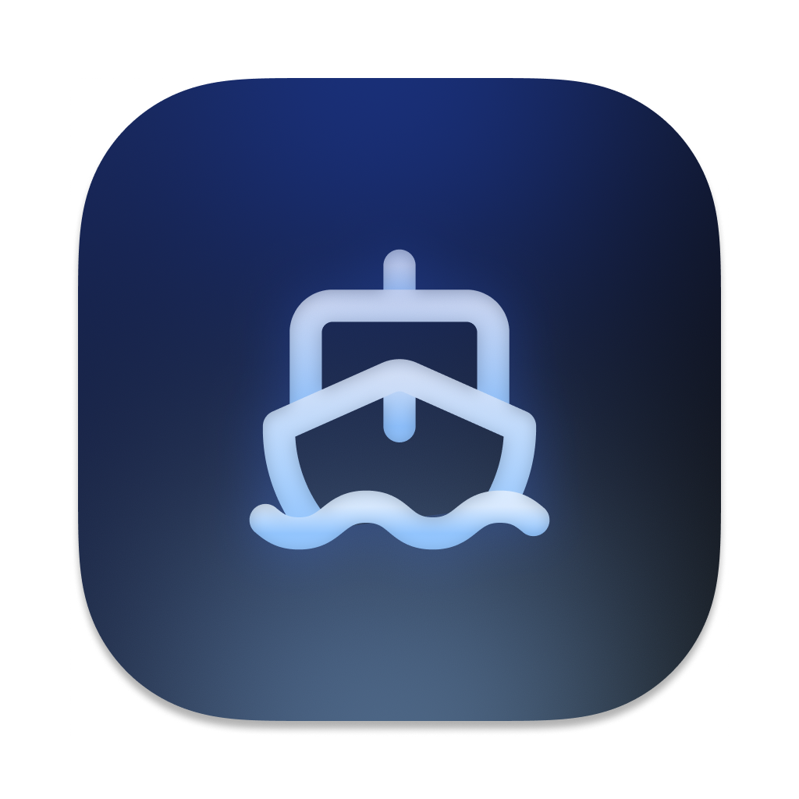
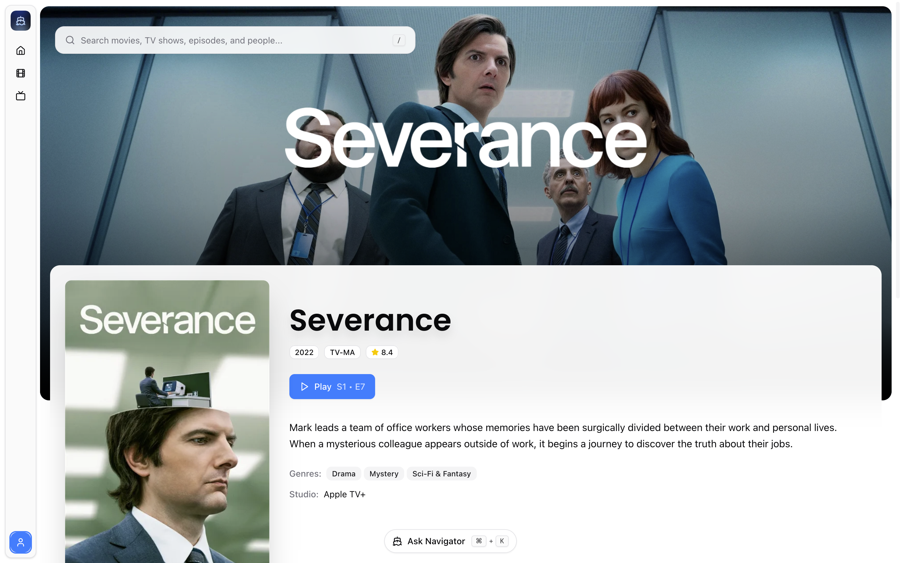

## Notice

Finetic has been succeeded by [Navigator](https://github.com/AyaanZaveri/navigator), a Stremio client for desktop and web.

<h1 align="center">
  <br>
    <a href="https://github.com/AyaanZaveri/finetic"></a>
  <br>
  Finetic
  <br>
</h1>
<h4 align="center">A Modern Jellyfin Client built w/ Next.js</h4>

https://github.com/user-attachments/assets/07fb5741-1edf-4655-9001-6df3e2b1c72b

<div align="center">
  <table>
    <tr>
      <td align="center">
        
      </td>
      <td align="center">
        
      </td>
    </tr>
  </table>
</div>

## Key Features

- **Navigator**: Interactive AI chat powered by Gemini for navigation
- **Media Player**: Feature-rich player with direct and transcoded playback, subtitle support, chapters, skip intro functionality
- **Library Management**: Browse and organize your movies, TV shows, and episodes
- **Theme Support**: Light and dark mode themes

## Built With

- **Frontend**: Next.js 15, React 19, TypeScript
- **Styling**: Tailwind v4, shadcn/ui, Framer Motion
- **AI**: Google Gemini 2.0 Flash with AI SDK
- **State Management**: Jotai for global state

## Getting Started

### Prerequisites

- Node.js 18+
- A running Jellyfin server
- Google AI API key (for AI features)

### Installation

1. **Clone the repository:**

   ```bash
   git clone https://github.com/AyaanZaveri/finetic
   cd finetic
   ```

2. **Install dependencies:**

   ```bash
   npm install
   # or
   yarn install
   # or
   bun install
   ```

3. **Configure environment variables:**

   Create a `.env.local` file in the root directory and add your configuration:

   ```env
   GOOGLE_GENERATIVE_AI_API_KEY=your_google_ai_api_key
   ```

### Development

1. **Start the web development server:**

   ```bash
   npm run dev
   # or
   yarn dev
   # or
   bun dev
   ```

   Open [http://localhost:3000](http://localhost:3000) to access the web app.

### Building for Production

**Build the web application:**

```bash
npm run build
npm run start
```

## Docker Deployment

### Quick Start with Docker Compose (Recommended)

The easiest way to run Finetic is using Docker Compose:

1. **Clone the repository:**
   ```bash
   git clone https://github.com/AyaanZaveri/finetic.git
   cd finetic
   ```

2. **Configure environment variables (optional):**
   ```bash
   cp .env.example .env.local
   # Edit .env.local and add your Google AI API key for AI features
   ```

3. **Run with Docker Compose:**
   ```bash
   docker-compose up -d
   ```

   The application will be available at [http://localhost:3000](http://localhost:3000)

### Manual Docker Build

If you prefer to build and run manually:

1. **Build the Docker image:**
   ```bash
   docker build -t finetic .
   ```

2. **Run the container:**
   ```bash
   docker run -d \
     --name finetic \
     -p 3000:3000 \
     -e GOOGLE_GENERATIVE_AI_API_KEY=your_api_key_here \
     finetic
   ```

### Environment Variables

| Variable | Description | Required |
|----------|-------------|----------|
| `GOOGLE_GENERATIVE_AI_API_KEY` | Google AI API key for AI navigator features | No |
| `NODE_ENV` | Node.js environment (automatically set to production in Docker) | No |

### Docker Considerations

- The Docker image uses Node.js 18 Alpine for optimal size and security
- The application runs as a non-root user for enhanced security
- Health checks are included to monitor container status
- The build uses multi-stage optimization to minimize the final image size
- Static files are properly served for optimal performance

### Updating

To update to the latest version:

```bash
# With Docker Compose
docker-compose pull
docker-compose up -d

# Manual
docker pull finetic:latest
docker stop finetic
docker rm finetic
# Run command again with latest image
```

## Available Scripts

- `dev` - Start Next.js development server with Turbopack
- `build` - Build the production application
- `start` - Start the production server
- `lint` - Run ESLint for code quality

## First-Time Setup

1. **Server Configuration**: On first launch, you'll be prompted to enter your Jellyfin server URL
2. **Authentication**: Login with your Jellyfin credentials
3. **AI Features**: The AI assistant will be available once you've configured your Google AI API key

## Usage

### AI Assistant

- Press `⌘ + K` to open the AI assistant
- Ask questions like:
  - "Play Inception"
  - "Go to Breaking Bad"
  - "Skip to the action scene"
  - "Explain what's happening right now"
  - "What's this movie about?"

#### Available AI Tools

The AI assistant has access to a comprehensive set of tools for media library interaction:

**🔍 Content Discovery & Search**

- `searchMedia` - Search for movies, TV shows, or episodes by name or keyword
- `getPeople` - Search for people (directors, actors) related to media content
- `getGenres` - Get list of all genres available in the library

**📺 Library Browse & Management**

- `getMovies` - Get a list of recent movies from the library
- `getTVShows` - Get a list of recent TV shows from the library
- `continueWatching` - Fetch list of media items currently being watched/continued
- `getWatchlist` - Get user's watchlist or favorites (popular/highly-rated content)
- `getMediaDetails` - Get detailed information about a specific movie or TV show
- `getSeasons` - Get seasons for a TV show
- `getEpisodes` - Get episodes for a TV show season

**🎬 Playback & Navigation**

- `navigateToMedia` - Navigate to a specific movie, TV show, or episode page
- `playMedia` - Play a specific movie, TV show, or episode directly in the media player

**🎯 Subtitle Analysis**

- `skipToSubtitleContent` - Intelligently analyze subtitles and find the best timestamp based on user descriptions (doesn't require exact text matches)
- `explainScene` - Analyze subtitles around current timestamp to explain what's happening in the scene
- `analyzeMedia` - Analyze the entire movie/episode using subtitles to answer questions about plot, characters, themes, etc.

**🌓 App Controls**

- `themeToggle` - Toggle or set the application theme between light, dark, or system mode

#### Smart Subtitle Features

When media is actively playing, the AI can:

- **Scene Navigation**: "Skip to the part where they talk about love" or "Take me to the action sequence"
- **Context Explanation**: "What's happening in this scene?" or "Who is talking right now?"
- **Content Analysis**: "What is this movie about?" or "Summarize this episode"
- Uses semantic understanding to find scenes based on descriptions, not just exact text matches

#### Search Intelligence

The AI automatically expands common abbreviations and handles vague descriptions:

- "b99" → "Brooklyn Nine-Nine"
- "the movie with the blue people" → "Avatar"
- "the show about meth" → "Breaking Bad"
- "the wizard movie" → "Harry Potter"

#### Example Queries

**Content Discovery:**

- "Show me my continue watching list"
- "What genres are available?"
- "Find movies with Tom Hanks"
- "Show me recent sci-fi movies"

**Navigation & Playback:**

- "Go to Breaking Bad"
- "Play Inception"
- "Show me seasons of The Office"

**Scene Navigation (during playback):**

- "Skip to when they arrive at the destination"
- "Take me to the emotional conversation scene"
- "Jump to the plot twist"

**Scene Analysis (during playback):**

- "What's happening right now?"
- "Explain this scene"
- "What did I miss?"
- "Who are the main characters in this movie?"

**App Control:**

- "Toggle the theme"

### Media Player

- Click any media item to start playback
- **Playback Options**:
  - **Direct Play**: Stream media files directly when supported by your browser
  - **Transcoding**: Automatic transcoding for unsupported formats or network optimization
  - The player automatically selects the best playback method based on your device and network conditions
- **Skip Intro Button**: Automatically detects and provides a skip button for TV show intros to jump directly to the main content
- Use keyboard shortcuts for control:
  - `Space` - Play/Pause
  - `←/→` - Seek backward/forward
  - `↑/↓` - Volume control
  - `F` - Toggle fullscreen

## Contributing

Please feel free to:

- Report bugs and issues
- Suggest new features
- Submit pull requests
- Improve documentation

If you find this project helpful, consider supporting its development:

<a href='https://ko-fi.com/V7V71J8WRS' target='_blank'></a>

## License

This project is licensed under the GNU General Public License v3.0 - see the [LICENSE](https://github.com/AyaanZaveri/finetic/blob/main/LICENSE) file for details.
