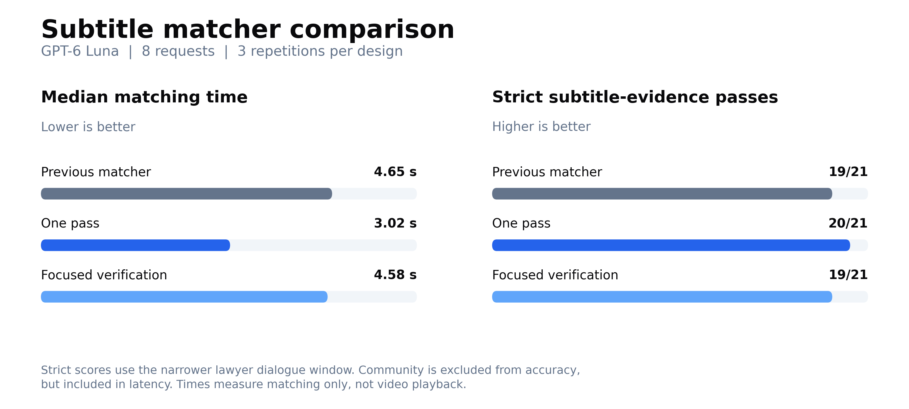
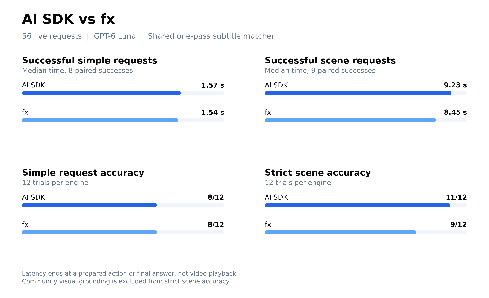

# Navigator evaluations

Live GPT-6 Luna evaluations from November 26, 2026. The results measure
prepared actions and subtitle evidence, not decoded video playback.

## Subtitle matcher



[Vector chart](subtitle-matcher.svg) · [Trial data](subtitle-matcher.csv) ·
[Method and limitations](../docs/navigator-subtitle-matching-playbook.md#live-architecture-comparison)

The 72 comparison rows include production matching and two experimental
paths. The two experimental rows in each trial share a proposal.
Community has no confirmed visual timestamp and is excluded from
accuracy. The one-pass matcher is now the default.

## Agent engines



[Vector chart](engine-pairs.svg) · [Trial data](engine-pairs.csv) ·
[Method and limitations](../docs/navigator-semantic-agent-evaluation.md#one-pass-matcher-paired-engine-recheck)

The 56 requests cover both ordinary media queries and scene searches.
Both engines use the same nested subtitle matcher. The latency charts
include only the pairs where both engines passed the strict criterion.
The data also includes failed requests and unconfirmed visual matches.

## Reproduce the charts

With Python 3 and matplotlib installed, run:

```sh
python3 evals/plot.py
```

The script exports 300 DPI PNG files and SVG files from the CSVs.
The CSVs contain only case labels, scores, timings, counts and selected
timestamps. They do not include subtitle transcripts, service credentials,
or private media URLs.
